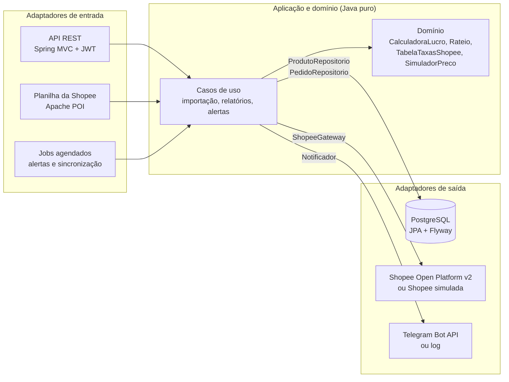

# Margem

**Quanto sobra de verdade de cada venda na Shopee.**

[](https://github.com/thibrown1/margem/actions/workflows/ci.yml)


API REST para quem vende na Shopee acompanhar o **lucro real** de cada pedido, controlar o estoque e receber alertas no Telegram.

**[Testar a versão para o lojista no navegador](https://thibrown1.github.io/margem/)**, com dados de exemplo e sem instalar nada.

<p align="center"></p>

---

## O problema

Este projeto nasceu da loja do meu sogro, que vende na Shopee.

Quem vende em marketplace sabe: o preço do anúncio não é o que cai na conta. Da venda saem a comissão da Shopee, a taxa fixa por item, o cupom que a loja ofereceu, o imposto, a embalagem e o custo do próprio produto. Sem fazer essa conta pedido a pedido, dá para vender muito e lucrar pouco, ou vender um produto no prejuízo por meses sem perceber.

Um exemplo com os números da tabela de taxas de 2026:

| Garrafa térmica vendida a R$ 59,90 | Valor |
|---|---:|
| Preço pago pelo cliente | R$ 59,90 |
| Comissão da Shopee (20%) | - R$ 11,98 |
| Taxa fixa por item | - R$ 4,00 |
| **Cai na conta** | **R$ 43,92** |
| Custo do produto | - R$ 22,40 |
| Imposto (4%) | - R$ 2,40 |
| Embalagem | - R$ 1,50 |
| **Lucro de verdade** | **R$ 17,62 (29,4%)** |

Um suporte de celular a R$ 19,90 que custa R$ 13,90 parece dar R$ 6,00 por venda. Na conta completa, cada venda dá **R$ 4,28 de prejuízo**.

## O que o Margem faz

- **Lucro real por pedido e por produto:** a conta aberta de cada venda, das taxas até o que sobra.
- **Importa a planilha da Central do Vendedor** (.xlsx) sem retrabalho: pode importar a mesma planilha várias vezes que nada se duplica.
- **Sincroniza pela API oficial da Shopee** (Open Platform v2), com assinatura HMAC e renovação automática do token. Para demonstração, uma **Shopee simulada** gera pedidos realistas sem precisar de credenciais.
- **Estoque que se atualiza sozinho:** a venda baixa o estoque, o cancelamento devolve, e a entrada de mercadoria recalcula o **custo médio ponderado**.
- **Relatórios:** faturamento, taxas, lucro e margem do período, para onde foi cada real vendido, ranking de lucro por produto e lista dos produtos vendidos no prejuízo.
- **Simulador de preço:** "vendendo a X, quanto sobra?" e "por quanto vender para ter 20% de margem?".
- **Alertas no Telegram:** pedido perto do prazo de envio, estoque baixo e pedido que deu prejuízo, numa mensagem só e sem repetir o mesmo aviso.
- **Dois perfis de acesso:** o dono vê tudo; quem cuida da expedição vê a fila de envio e o estoque, mas não vê valores.

## Uma descoberta do simulador: cobrar mais pode dar menos lucro

Na tabela da Shopee de 2026, a taxa fixa por item muda por faixa de preço: R$ 4,00 até R$ 79,99 e R$ 16,00 a partir de R$ 80,00. O simulador calcula automaticamente as faixas em que **subir o preço faz você ganhar menos**:

| Preço de venda | Comissão | Taxa fixa | Lucro (produto de R$ 31,50) |
|---:|---:|---:|---:|
| R$ 79,99 | 20% | R$ 4,00 | **R$ 23,79** |
| R$ 84,90 | 14% | R$ 16,00 | **R$ 20,61** |

Entre R$ 80,00 e R$ 88,77, qualquer preço rende menos do que vender a R$ 79,99. O endpoint `GET /api/simulador/faixas-a-evitar` lista todas essas faixas, e a simulação de um preço dentro delas já vem com o aviso.

## Arquitetura

O projeto segue **arquitetura hexagonal (portas e adaptadores)**. As regras de negócio não dependem de Spring, banco ou Shopee; as integrações entram por portas e podem ser trocadas sem mexer no domínio.



```
src/main/java/io/github/thibrown1/margem
├── dominio/        regras puras: lucro, rateio, taxas, simulador, estoque (sem Spring)
├── aplicacao/      casos de uso e portas (interfaces) que o domínio precisa do mundo externo
├── adaptador/
│   ├── entrada/    controllers REST, leitor da planilha, jobs agendados
│   └── saida/      JPA, API da Shopee, Shopee simulada, Telegram
├── configuracao/   monta os objetos de domínio a partir do application.yml
└── seguranca/      JWT, perfis DONO e EXPEDICAO
```

## Decisões técnicas

| Decisão | Por quê |
|---|---|
| `BigDecimal` no código e `NUMERIC(12,2)` no banco | Ponto flutuante erra centavos. Em conta de dinheiro, centavo errado é bug. |
| Custo congelado no item vendido | Se o produto ficar mais caro na próxima compra, o lucro das vendas antigas não muda. |
| Rateio com o centavo que sobra no último item | Cupom, taxas e embalagem são do pedido; divididos entre os itens, a soma sempre fecha com o total. |
| Importação idempotente | Importar a mesma planilha duas vezes não duplica pedido nem baixa estoque de novo. Um cancelamento posterior devolve o estoque. |
| Concorrência otimista (`@Version`) | Uma importação e uma entrada de estoque ao mesmo tempo não sobrescrevem uma à outra: a segunda recebe HTTP 409. |
| Taxas da Shopee em configuração | A Shopee muda a tabela de tempos em tempos. Mudar o `application.yml` basta, sem recompilar. |
| LGPD por design | A planilha da Shopee traz nome, telefone e endereço do comprador. O leitor só lê as colunas necessárias ao cálculo; dado pessoal nunca entra no sistema. |
| Portas para Shopee e Telegram | A Shopee real exige cadastro aprovado na Open Platform. Com a porta `ShopeeGateway`, a demonstração usa uma Shopee simulada e a produção usa a API, sem mudar nenhuma regra. |
| Alertas sem spam | Cada alerta enviado fica registrado; o mesmo aviso só volta depois do intervalo configurado. Se o Telegram falhar, nada é marcado como enviado e a próxima verificação tenta de novo. |
| Erros no padrão RFC 9457 | Toda resposta de erro tem o mesmo formato (`ProblemDetail`), com mensagem em português. |

## Versão para o lojista (sem instalar nada)

Meu sogro não vai abrir o Swagger. Por isso a mesma regra de lucro também existe numa página única ([`docs/index.html`](docs/index.html)), publicada no GitHub Pages: ele envia a planilha exportada da Central do Vendedor e vê o lucro do mês, os produtos no prejuízo, a conta de cada pedido e o simulador de preço.

- A planilha é lida no próprio navegador; nada vai para servidor, e nome, telefone e endereço dos clientes não são lidos.
- Os custos ficam salvos no navegador, com opção de copiar para outro aparelho.
- Os casos de teste do backend foram conferidos contra a versão em JavaScript, e as duas dão o mesmo resultado, centavo por centavo.

## Como rodar

**Com Docker** (recomendado):

```bash
docker compose up --build
```

Abra http://localhost:8080 (Swagger UI). O perfil `demo` já vem com produtos de exemplo e 45 dias de pedidos da Shopee simulada.

| Usuário | Senha | Perfil |
|---|---|---|
| `dono` | `dono123` | vê tudo |
| `expedicao` | `expedicao123` | fila de envio e estoque |

No Swagger: faça login em `POST /api/auth/login`, copie o token, clique em **Authorize** e cole.

**Sem Docker** (precisa de Java 21 e um PostgreSQL rodando):

```bash
mvn spring-boot:run -Dspring-boot.run.profiles=demo
```

A pasta [`http/`](http/margem.http) tem as requisições prontas para a extensão REST Client do VS Code, e a pasta [`exemplos/`](exemplos) tem uma planilha no formato da exportação da Shopee, com dados fictícios, para testar a importação.

## Endpoints

| Método | Rota | Perfil | O que faz |
|---|---|---|---|
| POST | `/api/auth/login` | público | Login, devolve o token JWT |
| POST | `/api/produtos` | DONO | Cadastra produto (e preenche o custo de vendas antigas do mesmo SKU) |
| GET | `/api/produtos` | DONO | Lista produtos com custo e estoque |
| PUT | `/api/produtos/{sku}` | DONO | Atualiza nome, custo e estoque mínimo |
| POST | `/api/produtos/{sku}/entradas` | DONO | Chegada de mercadoria, recalcula o custo médio |
| GET | `/api/estoque` | DONO, EXPEDICAO | Estoque do mais urgente para o mais tranquilo |
| POST | `/api/pedidos/importacoes` | DONO | Importa a planilha .xlsx da Central do Vendedor |
| POST | `/api/pedidos/sincronizacoes?dias=7` | DONO | Busca pedidos recentes na Shopee |
| GET | `/api/pedidos` | DONO, EXPEDICAO | Lista pedidos por período e status (paginado) |
| GET | `/api/pedidos/a-enviar` | DONO, EXPEDICAO | Fila de expedição por prazo |
| GET | `/api/pedidos/{codigo}/lucro` | DONO | Conta aberta do pedido |
| GET | `/api/relatorios/resumo` | DONO | Faturamento, taxas, lucro e composição do período |
| GET | `/api/relatorios/produtos` | DONO | Lucro por produto |
| GET | `/api/relatorios/prejuizo` | DONO | Produtos vendidos no prejuízo |
| POST | `/api/simulador/lucro` | DONO | Lucro de um preço de venda |
| POST | `/api/simulador/preco-ideal` | DONO | Menor preço para atingir uma margem |
| GET | `/api/simulador/faixas-a-evitar` | DONO | Faixas em que subir o preço reduz o lucro |
| GET | `/api/simulador/taxas` | DONO | Tabela de taxas usada nos cálculos |
| POST | `/api/alertas/verificacoes` | DONO | Verifica e envia os alertas agora |

## Integrações

**Telegram:** crie um bot com o [@BotFather](https://t.me/BotFather), mande uma mensagem para ele e pegue o `chat_id`. Depois defina `TELEGRAM_BOT_TOKEN`, `TELEGRAM_CHAT_ID` e `MARGEM_ALERTAS_HABILITADOS=true`. Sem Telegram, os alertas aparecem no log.

**Shopee:** a integração usa a [Shopee Open Platform](https://open.shopee.com) v2 (pedidos, detalhes e repasse com as taxas). É preciso ter cadastro de desenvolvedor aprovado e a loja autorizar o app. Com as credenciais em mãos, defina `SHOPEE_MODO=api` e as variáveis `SHOPEE_*` do [`.env.example`](.env.example).

**Tabela de taxas:** fica em `margem.tabela-taxas` no [`application.yml`](src/main/resources/application.yml). Os valores são os divulgados para vendedores a partir de 01/03/2026; confira na Central do Vendedor antes de usar em produção.

## Testes

```bash
mvn verify
```

- **Unitários** (JUnit 5, Mockito, AssertJ): regras de lucro, rateio, custo médio, tabela de taxas e simulador com valores calculados à mão; casos de uso com repositórios em memória; leitor da planilha; adaptadores da Shopee e do Telegram com `MockRestServiceServer`, incluindo a assinatura HMAC conferida contra um valor calculado fora do Java.
- **Integração** (`*IT`, Spring Boot Test + MockMvc): o fluxo inteiro pela API, segurança por perfil e concorrência otimista.
- **CI** (GitHub Actions): roda tudo com H2 e de novo contra um **PostgreSQL 16 de verdade**, gera o relatório de cobertura (JaCoCo) e faz o build da imagem Docker.

## Próximos passos

- Guardar os tokens da Shopee no banco (o refresh token muda a cada renovação)
- Receber pedidos por webhook da Shopee em vez de consultar periodicamente
- Painel web para o dono da loja acompanhar os números
- Suporte a mais de uma loja e a outros marketplaces
- Limite de tentativas no login

## Autor

**Thiago Santos**, desenvolvedor backend Java em transição de carreira (vindo de monitoração e suporte), pós-graduando em Arquitetura e Desenvolvimento Java na FIAP.

[GitHub](https://github.com/thibrown1)
